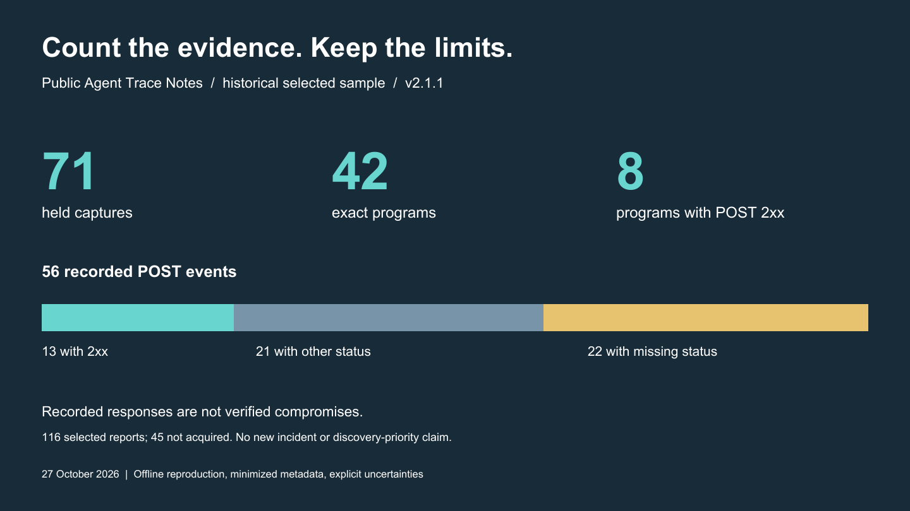

# Public Agent Trace Notes

**From public traces to defensible claims.**

An annotation dataset and technical note on historical incident-related agent traces. Recompute four headline tables, identify every missing capture, and inspect the limits of each claim using only the included files.



| Start here | What you get |
|---|---|
| [Research paper](paper/PAPER.md) · [PDF](paper/paper.pdf) | Findings, methods and a first-page description of the deliverable and its limits |
| [Replay guide](paper/REPRODUCING.md) | Commands, expected tables and the exact missing-capture list |
| [Governance brief](paper/GOVERNANCE_BRIEF.md) · [PDF](paper/governance-brief.pdf) | Questions for platform telemetry and review |
| [Evidence appendix](paper/EVIDENCE_APPENDIX.md) · [PDF](paper/evidence-appendix.pdf) | Coverage, provenance and verification levels |
| [Complete v2.1.1 ZIP](distribution/public-agent-trace-notes-v2.1.1.zip) · [SHA-256](distribution/public-agent-trace-notes-v2.1.1.sha256) | The exact 27-file distribution |
| [Claim ledger](paper/claims.json) · [Sources](paper/SOURCES.md) | Evidence bindings and prior work |

## What the dataset shows

Of 116 selected reports, 71 acquired captures represent 42 exact programs. Their 56 recorded POST events include 13 with 2xx responses across eight programs and 22 without a response status. The [selection ledger](paper/data/capture-selection.csv) identifies all 45 not-acquired reports.

The contribution is inspectable annotation and replayable arithmetic. These counts do not establish compromised accounts, independent operators or a new incident. Raw-source extraction and independent historical validation are outside the public replay.

## Try it locally

Python 3.10+ and its standard library are sufficient. No model calls, credentials, dependency installation or incident-code execution are required.

```sh
cd paper
python -B verify.py
python -B verify.py --tables
python -B verify.py --missing
python -B -m unittest discover -s tests -v
```

Save command output outside `paper/`: the integrity check rejects unlisted files. The [replay guide](paper/REPRODUCING.md) explains expected results and managed-Windows temporary-directory handling.

## Verification status

Version 2.1.1 clarifies the event unit: a recorded request entry within a capture, with a response status when available. The data and quantitative findings are unchanged; earlier ZIPs remain in `distribution/`.

Version **2.1.1 · 27 October 2026**. An author-run replay from a freshly extracted ZIP passed all four commands and 22 tests. A separate arithmetic implementation agreed with the four tables, the absent-ID list and the paper's POST/year table cells. See [release checks](RELEASE_CHECKS.md).

This is AI-assisted work and has not been peer reviewed or independently reproduced by another investigator. Hashes establish byte identity, not source truth or discovery priority. [Revision history](paper/CHANGELOG.md).

## Useful review questions

- Do these exact annotations overlap with earlier analyses or the larger Swarm Traces corpus?
- Can the catalog's unresolved dates and classes be clarified at record level?
- Does any table or interpretation disagree with the evidence available to you?

Please cite the version and relevant report ID or table cell. Follow the [security and disclosure policy](paper/SECURITY.md): do not put operational payloads, credentials or private logs in issues. Only minimized, body-free metadata is distributed.

## Rights

The repository is available for reading and discussion. No open-source or content license has yet been granted; third-party rights remain with their owners. Public availability does not change those rights.
